


  

  


I'm a data analytics professional based in Pune with **4+ years of enterprise experience** in Power BI, TIBCO Spotfire and TIBCO Data Virtualization (TDV), including dashboard delivery for **FedEx APAC** at Atos Syntel, where I received spot recognition from the company CEO and the client.

Today I combine that BI foundation with Generative and Agentic AI work: RAG, LLM orchestration and natural-language analytics copilots. I also mentor and train teams on Power BI, Tableau, SQL, Python and AI, and I'm available as an **immediate joiner**.



**Also earned:** Applied Skills: AI Chat Workflows (Microsoft) · Python for Data Science (IBM) · SQL & Python Advanced and Software Engineer (HackerRank) · Scrum Foundation and BI Foundation (Certiprof)


**Publications:** *IoT Based Fire Control System for Four-Wheeler* (IJIRCCE, Vol. 10, Issue 2, 2022) · *Hallucination Drift in Retrieval-Augmented Generation Systems*

<a href="https://pravesh-recruiting-pipeline-co-pilot.apps.lemma.work"></a>

More work, including the SkyTrail desktop app and the Sales & Business Performance dashboard, is on my [portfolio](https://ashwikbire.github.io/My-Portfolio/).

<picture>
  <source media="(prefers-color-scheme: dark)" srcset="https://ghchart.rshah.org/C77B9B/AshwikBire">
  
</picture>

<picture>
  <source media="(prefers-color-scheme: dark)" srcset="https://github-readme-stats.vercel.app/api?username=AshwikBire&show_icons=true&hide_border=true&bg_color=190B12&title_color=E5B5C7&text_color=F8F0F3&icon_color=C77B9B&ring_color=C77B9B">
  
</picture>

 

